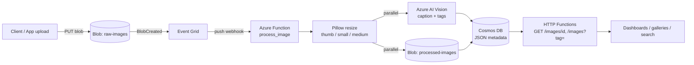

# Automated Event-Driven Image Intelligence & Processing Pipeline

Serverless Azure pipeline: **upload an image → it is resized, captioned, tagged and indexed automatically**, with no servers to manage.

*Academic project, Jan–Apr 2026 (Prof. Sougata Mukherjea).*

## Architecture



## Workflow

1. A file lands in `raw-images` (any app, SDK, portal, or `azcopy`).
2. Storage emits `BlobCreated`; **Event Grid pushes it** to the function (no polling delay).
3. The function reads the blob and **Pillow** produces 3 JPEG variants (128 / 480 / 1024 px), EXIF-rotated, alpha flattened, never upscaled.
4. In parallel: variants are written to `processed-images`, and the largest variant is sent to **Azure AI Vision** (smaller payload, faster call).
5. One JSON document is **upserted into Cosmos DB** (caption, tags + confidence, variant paths, timings, status).
6. Real-time apps read results through the HTTP endpoints or the Cosmos **change feed**.

Output goes to a *different* container from the input, so the pipeline can never trigger itself.

## Reliability design

| Concern | Handling |
|---|---|
| Event Grid is at-least-once | Deterministic doc id + `overwrite=True` + upsert = idempotent |
| Corrupt / non-image / huge file | Stored as `status: rejected`, no retry loop |
| Vision throttling (429/5xx) | Exponential-backoff retries (tenacity); on final failure `status: partial`, resized images kept |
| Blob/Cosmos write failure | Exception propagates, Event Grid re-delivers |
| Decompression bombs | `Image.MAX_IMAGE_PIXELS` cap |
| Cold-start cost | Clients created once per worker (`lru_cache`) |

## Repo layout

```
function_app.py          # triggers + HTTP routes (thin wiring)
host.json
src/
  config.py              # settings from env
  models.py              # doc schema, deterministic ids
  image_processor.py     # Pillow logic (no Azure imports)
  vision_service.py      # AI Vision wrapper + retries
  blob_service.py        # upload variants
  cosmos_repository.py   # upsert / get / search by tag
  pipeline.py            # orchestration, failure policy
tests/                   # unit tests with fakes (no Azure needed)
scripts/
  benchmark_resize.py    # local Pillow latency benchmark
  run_test_cycles.py     # N-image end-to-end success-rate test
infra/provision.sh       # az CLI: storage, Cosmos, Vision, Function, Event Grid
.github/workflows/ci.yml # ruff + pytest
```

## Quick start

```bash
python -m venv .venv && source .venv/bin/activate
pip install -r requirements-dev.txt
pytest -q                                   # unit tests, no Azure needed
python -m scripts.benchmark_resize          # resize latency on your machine

# Deploy to Azure
az login
./infra/provision.sh
```

## Measuring the headline numbers

```bash
python -m scripts.benchmark_resize --runs 100          # resize time (mean / p95)
python -m scripts.run_test_cycles --count 100          # success rate over 100 cycles
```
Report what you measure: resize time depends on input size and hardware, and success rate depends on Vision quota/region.

## API

| Endpoint | Description |
|---|---|
| `GET /api/images/{id}` | Full metadata document |
| `GET /api/images?tag=dog&limit=20` | Search by tag, newest first |

## Local development note

Event Grid cannot reach `localhost` directly. Either expose the Functions host with a tunnel (ngrok / dev tunnels) and point an Event Grid subscription at it, or test the logic locally with `pytest` and the benchmark script.

## Extending for production

Managed identity instead of keys (leave `VISION_KEY` / `COSMOS_KEY` unset), dead-letter container on the Event Grid subscription, Application Insights alerts on `status != processed`, Cosmos change feed → SignalR for live UI updates, private endpoints.
